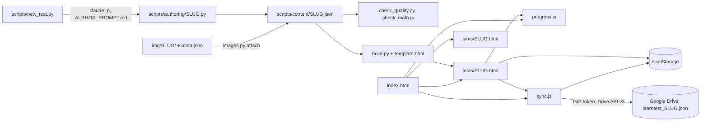

# learning-test: documentation hub

learning-test is a static site of self-marking study tests served from GitHub
Pages (`README.md:3`, `CLAUDE.md:3-5`). Each test has 50 multiple-choice
questions with four options, an explanation and a worked "without this / with
this" example (`README.md:7-9`). The questions live in JSON files, and a Python
script bakes them into one HTML page per test (`scripts/build.py`). The
browser keeps progress in `localStorage` and can merge it with Google Drive
(`progress.js`, `sync.js`). The UI and the content are in Russian (`index.html:2`,
`scripts/template.html:2`). `scripts/authoring/AUTHOR_PROMPT.md:12` names the
repository owner as the intended learner. The code does not say whether anyone
else uses the site (see [SPEC.md](../SPEC.md#9-open-questions)).

## Status

- Last commit: 2026-11-10 21:04:29 +0300, `f31a945`. The history has 112 commits,
  the first on 2026-07-12 (`git log`).
- Contents at `f31a945`: 52 tests (`scripts/build.py:12-68`, `index.html:119-172`),
  2600 questions, 19 interactive labs (`sims/`, `index.html:185-205`) and 1415
  question images across 29 tests (`python scripts/images.py check`).
  `openbmc_bmc` has 15 of 50 images. The other 23 tests have none.
- Tests: five check scripts, run by hand. Nothing runs automatically: the
  repository has no `.github/` directory and no CI config. `CLAUDE.md:193` refers
  to GitHub's built-in `pages build and deployment` workflow, which is not
  stored in the repository. All five checks passed at `f31a945` (see
  [Testing](#testing)).
- No `TODO`/`FIXME` markers in the code (`git grep`). The only hits are the
  `todo` status key.
- Evidently unfinished or stale:
  - The patch data in `scripts/balanced/` and `scripts/parenfix/` no longer
    matches the content. `apply_balanced.py --check` fails for 14 of 19 tests
    (108 problems). `apply_parenfix.py --check` fails for 2 of 13 tests
    (3 problems).
  - 33 of 52 tests have no lab (`"sim": ""` in `scripts/build.py`).
  - The spaced-repetition feature ("Пора повторить") was removed on 2026-10-17
    (`CLAUDE.md:41-43`, `progress.js:12-13`). A template comment still mentions
    it (`scripts/template.html:254-255`).

## Layout

| Path | What it is |
|---|---|
| `index.html` | Home page: test list grouped by status, "Продолжить" card, labs, sync controls (`TESTS`, `SIMS` arrays) |
| `tests/<slug>.html` | Generated test pages, one per test, written by `build.py` (`README.md:19-20`) |
| `sims/<slug>.html` | 19 standalone interactive labs (13 of them draw on a `<canvas>`). They link back to the test and the index |
| `progress.js` | Shared progress logic (status, mistakes, which copy is newer, TSI course name), used by the browser and by Node |
| `sync.js` | Google Drive synchronisation of all `learntest_*` keys (`window.LTSync`) |
| `config.js` | `window.GOOGLE_CLIENT_ID` for Drive sync |
| `vendor/katex/` | Bundled KaTeX 0.19.1 for formulas (`vendor/katex/README.txt`) |
| `img/<slug>/NN.svg`, `img/<slug>/meta.json` | Question images and their alt/credit captions |
| `scripts/content/<slug>.json` | Source of each test: 50 questions, compact JSON, one question per line |
| `scripts/template.html` | Test page template with placeholders `__TITLE__`, `__TEST_ID__`, `__SIM_LINK__`, `__QUESTIONS_JSON__` |
| `scripts/build.py` | Test registry (`TOPICS`) and the generator of `tests/*.html` |
| `scripts/check_quality.py` | Checks that the right answer cannot be told from its form |
| `scripts/check_math.js` | Parses every LaTeX fragment with KaTeX |
| `scripts/images.py` | Checks images, attaches them to content, renders contact sheets |
| `scripts/math_sheet.py`, `scripts/sheet_shot.js` | PNG preview sheets through headless Chrome (CDP) |
| `scripts/new_test.py` | One-command test creation through a detached `claude -p` author process |
| `scripts/authoring/` | Author prompt (`AUTHOR_PROMPT.md`) and Python sources that generate some content files |
| `scripts/shuffle_options.py`, `apply_balanced.py`, `apply_parenfix.py`, `apply_practical.py`, `merge_usage.py` | One-off content editing tools with integrity checks and a `--check` mode |
| `scripts/balanced/`, `parenfix/`, `practical/`, `usage/` | Patch data read by the four `apply_*`/`merge_*` tools |
| `scripts/test_progress.js`, `scripts/test_shuffle.js` | Node checks for progress/sync logic and the option shuffle |
| `scripts/fetch_tasks.py`, `scripts/filter_learning_tasks.py` | Download Google Tasks and pick study-related ones (writes git-ignored files) |
| `.claude/launch.json` | Local static server configuration (port 8123) |
| `CLAUDE.md` | Rules for writing tests, images and formulas, and the content workflow (Russian) |

## Architecture

Nothing runs on a server. The site is static files. The tooling is a set of
local Python and Node scripts that produce those files.

- **Content pipeline.** You edit `scripts/content/<slug>.json` by hand, generate
  it with `scripts/authoring/<slug>.py`, or let the `scripts/new_test.py` author
  process write it. `images.py attach` adds `img` fields from `img/<slug>/`.
  `check_quality.py` and `check_math.js` check the content. `build.py` replaces
  the template placeholders and writes `tests/<slug>.html`
  (`scripts/build.py:92-99`).
- **Test page.** It loads `config.js`, `progress.js`, `sync.js` and KaTeX
  (`scripts/template.html:163-167`). On every load it shuffles the options and
  remaps `correct` (`scripts/template.html:233-244`). Its state lives in
  `localStorage["learntest_<slug>"]`.
- **Home page.** It reads the `learntest_<slug>` key of each test in `TESTS` and groups the tests
  with `LTProgress` (`index.html:323-344`).
- **Sync.** `sync.js` gets an OAuth access token from Google Identity Services
  (`https://accounts.google.com/gsi/client`, scope `drive.file`). Through Drive
  API v3 it reads and writes one file per test, `learntest_<slug>.json`, with
  the same JSON as `localStorage` (`sync.js:11-12`, `sync.js:19-22`).
- **New-test job.** `new_test.py` starts a detached process. That process runs
  the `claude` CLI, repeats the checks, edits `index.html`, commits and pushes
  to `main`. It then calls two scripts outside this repository: a Telegram
  notifier and an image runner (`scripts/new_test.py:37-39`, `164-212`).

## Build and run

Prerequisites. The repository has no `package.json`, `requirements.txt` or lock
file, so the versions below are what the code uses, not declared minimums.

- Python 3. `.claude/launch.json:6` points to a Python 3.13 interpreter, and the
  checks below ran with 3.13.3. `build.py`, `check_quality.py`, `images.py`,
  `math_sheet.py` and `new_test.py` import only the standard library.
- Node.js for `check_math.js`, `test_*.js` and `sheet_shot.js`. No version is
  declared. `sheet_shot.js` uses the global `fetch` and `WebSocket`. The checks
  below ran with v23.11.0.
- Google Chrome for the preview sheets. The default path is a Windows install
  location, and `CHROME_PATH` overrides it (`scripts/sheet_shot.js:9`).
- For `new_test.py`: the `claude` CLI on PATH or `LT_CLAUDE`, and `git` with push
  rights (`scripts/new_test.py:143`, `194-203`).
- For `fetch_tasks.py`: `google-auth` and `google-api-python-client`
  (`scripts/fetch_tasks.py:3-5`). No file in the repository declares them.

Install: none. Python and Node scripts run straight from the checkout.

| Step | Command | Source |
|---|---|---|
| Rebuild all test pages | `python3 scripts/build.py` | `README.md:34`, `CLAUDE.md:23` |
| Check content quality | `python3 scripts/check_quality.py [slug ...]` | `README.md:35`, `scripts/check_quality.py:16-17` |
| Check formulas | `node scripts/check_math.js [slug ...]` | `CLAUDE.md:166`, `scripts/check_math.js:4-5` |
| Check shuffle wiring | `node scripts/test_shuffle.js` | `CLAUDE.md:21`, `scripts/test_shuffle.js:5` |
| Check progress and sync logic | `node scripts/test_progress.js` | `CLAUDE.md:178`, `scripts/test_progress.js:2` |
| Serve locally on port 8123 | `python -m http.server 8123` | `.claude/launch.json:5-8` |
| Publish | Merge into `main`. GitHub Pages serves `main` | `README.md:31`, `CLAUDE.md:186-187` |

## Configuration

| Name | Where | Meaning | Default |
|---|---|---|---|
| `GOOGLE_CLIENT_ID` | `config.js:5` (`window.GOOGLE_CLIENT_ID`) | OAuth Web client ID for Drive sync. If empty, sync is off and tests work offline (`config.js:1-4`, `sync.js:25-27`) | Set in the repository (value not copied here) |
| `TOPICS` | `scripts/build.py:12-68` | Registry for the generator: `slug -> {title, sim}`. `sim` is empty (no lab button), a slug (`sims/<slug>.html`) or an `http(s)` URL (new tab) | n/a |
| `TESTS`, `SIMS` | `index.html:119-172`, `185-205` | Home page lists of `[slug, title]`. A separate title registry from `TOPICS` | n/a |
| `?mode=mistakes` | `scripts/template.html:540-542` | Opens a test page in "Работа над ошибками" mode | normal pass |
| `LT_CLAUDE` | env, `scripts/new_test.py:21`, `143` | Path to a `claude` replacement (for runs against a stub) | `claude` |
| `LOCALAPPDATA` | env, `scripts/new_test.py:35` | Base of the job directory `learning-test/jobs` | home directory if unset |
| `CHROME_PATH` | env, `scripts/sheet_shot.js:9` | Chrome executable for screenshots | Windows default install path |
| `new_test.py` flags | `scripts/new_test.py:216-225` | `--title`, `--topic` (required), `--slug`, `--source` (repeatable, must exist), `--model`, `--no-images`, `--no-push`, `--no-commit` | `--model opus`. Slug derived from title |
| Quality thresholds | `scripts/check_quality.py:33-37` | 50 questions, 4 options, each position at least 5 times, "correct is strictly longest" at most 35%, mean length within 15% | constants |
| Image limits | `scripts/images.py:30-32`, `85-126` | SVG up to 60 KB, raster up to 900 KB, `viewBox` width 480 and height 240..360, white first `rect`, font at least 16, stroke at least 1.5 | constants |
| `scripts/token.json`, `scripts/credentials.json` | git-ignored (`.gitignore:1-2`) | `token.json`: Google OAuth user token read by `fetch_tasks.py` (`scripts/fetch_tasks.py:13`, `16`). No script reads `credentials.json` | absent in a fresh clone |

Browser storage keys: `learntest_<slug>` (test state, synced),
`ltindex_last` and `ltindex_open` (home page, not synced because they lack the
prefix), `gdrive_access_token` and `gdrive_token_expiry` (cached token)
(`scripts/template.html:172`, `195`, `index.html:218`, `sync.js:19-21`).

## Usage

1. **Take a test.** Open the site, pick a test, answer. The first answer to each
   question is final. The explanation and the example appear after you answer
   (`scripts/template.html:256-285`, `314-316`). The home page offers
   "Продолжить" for the last unfinished test (`index.html:299-321`).
2. **Work on mistakes.** After the result screen, or from the group "Работа над
   ошибками" on the home page, the page goes through the questions answered
   wrong the first time. A correct answer marks a question fixed but does not
   change the score (`scripts/template.html:378-456`, `progress.js:43-52`).
3. **Sync between devices.** Tap "Синхронизировать всё" or the line under the
   title, then sign in to Google. For each test the newer copy wins. While the
   token is alive (about an hour) the home page merges on open, and test
   pages upload 4 s after each answer (`index.html:377-403`,
   `scripts/template.html:203-216`).
4. **Add a test with one command** (`CLAUDE.md:106`):
   `python scripts/new_test.py --title "TSI DSP 5: Тема" --topic "что покрыть" [--source ПУТЬ ...]`.
   The command returns at once. Progress goes to
   `%LOCALAPPDATA%\learning-test\jobs\<slug>.log` (`CLAUDE.md:112`).
5. **Edit content by hand** (`CLAUDE.md:170-187`): edit
   `scripts/content/<slug>.json`, run `python3 scripts/check_quality.py` and
   `node scripts/check_math.js`, then `python3 scripts/build.py`, then
   `node scripts/test_shuffle.js` if the template changed.
6. **Add images** (`CLAUDE.md:117-151`, `scripts/images.py:8-11`): put
   `img/<slug>/NN.svg` and `meta.json` in place, run
   `python scripts/images.py attach <slug>`, then `python scripts/images.py check`.
   To inspect them, run `python scripts/images.py sheet <slug>` and
   `python scripts/images.py frames <slug>`.
7. **Preview formulas** (`scripts/math_sheet.py:4`): `python scripts/math_sheet.py <slug> [--all]`.

## Testing

| Check | What it covers | Result at `f31a945` |
|---|---|---|
| `python3 scripts/check_quality.py` | Counts, option validity, position balance, length tells, parenthesis tells, LaTeX only in the correct option, unbalanced delimiters, missing image file or alt | 52 OK, exit 0 |
| `node scripts/check_math.js` | Every `\( \)` and `\[ \]` fragment parses in KaTeX | 2799 formulas, 0 errors |
| `node scripts/test_shuffle.js` | Takes the real `shuffle` and `buildShuffledQuestions` code from the template. Checks that the answer key follows the options, that `selectedText` survives a reshuffle, that no option text repeats within a question, and that all 52 built pages are wired to the shuffle | ALL CHECKS PASSED (7800 question shuffles) |
| `node scripts/test_progress.js` | `progress.js` functions, and `sync.js` merge against a fake Drive: newer copy wins, PATCH and not a duplicate POST, a listing failure is an error, auto mode needs no login, `uploadOne` | 9 checks passed |
| `python scripts/images.py check` | Image files, sizes, format rules, offline-only SVG, full correct option written on the image | 1415 images, 0 errors |

There are no browser or UI tests. `CLAUDE.md:184-185` asks for a manual
browser check.

## Known limitations and problems

Measured from code or check runs unless marked as suspected.

- **No CI and no dependency manifest.** Checks run only by hand or inside
  `new_test.py` (`scripts/new_test.py:126-135`).
- **Two title registries.** Home page titles (`index.html:119-172`) and page
  titles (`scripts/build.py:12-68`) are kept apart and differ. For example,
  `index.html:150` and `scripts/build.py:47` give different titles for
  `dsp_fourier_series_spectra`. `new_test.py` writes both
  (`scripts/new_test.py:81-109`). Manual additions must edit both, and also
  `SIMS` for a new lab (`CLAUDE.md:33`).
- **Fixed block names.** Every test shows the same five block names
  (`scripts/template.html:173-179`). The author prompt asks for a different
  five-block structure (`scripts/authoring/AUTHOR_PROMPT.md:14-19`).
- **Sync error handling outside `syncAll`.**
  - `downloadAll` uses the lenient listing, so when Drive does not answer it
    reports "Загружено тестов: 0" instead of an error (`sync.js:105-111`,
    `183-185`).
  - The per-file fetch there does not check `r.ok` (`sync.js:189`).
    Suspected: an error body could be stored as progress.
  - `uploadAll` counts unreadable local values as sent (`sync.js:166`).
  - `findFile` returns `null` on any failure, and `uploadFile` then creates a
    new file with the same name (`sync.js:97-103`, `125-134`). Suspected:
    duplicate Drive files after a network error. No test covers this path.
- **Drive listing.** At most 1000 files, with no pagination (`sync.js:107`,
  `118`).
- **Token storage.** The Google access token is kept in `localStorage`
  (`sync.js:39-44`).
- **Stale patch data.** See [Status](#status). The tools stay idempotent, but
  running `apply_balanced.py` without `--check` still overwrites the options of
  the tests that pass its validation (`scripts/apply_balanced.py:98-101`).
- **Authoring scripts and images.** The authoring scripts rewrite the content
  JSON from their own data. Only `openbmc_bmc.py` carries `img` fields over
  (`scripts/authoring/openbmc_bmc.py:624-625`). Inference: re-running the
  other scripts drops images until `images.py attach` runs again.
- **`new_test.py` depends on this machine and pushes straight to `main`.**
  - It needs two scripts at absolute Windows paths outside the repository
    (`scripts/new_test.py:38-39`). If they are missing, the Telegram notice and
    the images are skipped without a message (`scripts/new_test.py:121`, `207`).
  - It pushes to `origin main` (`scripts/new_test.py:203`). `CLAUDE.md:191` says
    development happens on a separate branch.
  - Stated duration differs: 15–60 min (`CLAUDE.md:108`) and 40–60 min
    (`scripts/new_test.py:9`). The hard timeout is 150 min
    (`scripts/new_test.py:152`).
  - The author prompt names a fixed absolute repository path
    (`scripts/authoring/AUTHOR_PROMPT.md:1`). The process runs in the
    checkout's root (`scripts/new_test.py:113`).
- **Windows-only preview tooling.** `sheet_shot.js` uses `taskkill`,
  PowerShell and a Windows Chrome path (`scripts/sheet_shot.js:9`, `34-41`).
  `CLAUDE.md:184-185` refers to Playwright at a Linux path. No script in the
  repository uses Playwright.
- **Task harvesting.**
  - `filter_learning_tasks.py` matches keywords as case-insensitive substrings
    with no word boundaries (`scripts/filter_learning_tasks.py:24`). Inference:
    words that merely contain a keyword (for example, `test` inside `latest`)
    also match.
  - `fetch_tasks.py` has no first-time OAuth flow. It only loads and refreshes
    `token.json` (`scripts/fetch_tasks.py:15-23`).
- **Old progress.** Progress written before answers were stored as text keeps
  its score but not the highlight of the wrong option (`CLAUDE.md:19-20`).

## Related documents

- [Project README](../README.md): overview and publishing.
- [SPEC.md](../SPEC.md): requirements specification reverse-engineered from the code.
- [CLAUDE.md](../CLAUDE.md): full rules for tests, images, formulas, and the content workflow (Russian).
- [Author prompt](../scripts/authoring/AUTHOR_PROMPT.md): instructions given to the `claude -p` test author.
- [KaTeX vendoring note](../vendor/katex/README.txt) and [KaTeX licence](../vendor/katex/LICENSE).
- [LICENSE](../LICENSE): MIT.

## About this document

Written 2026-11-18 from commit `f31a945` (branch `docs/spec-and-docs`, cut from
`origin/main`).

Commands run to check it (all read-only):

- `git status`, `git log`, `git ls-files`, `git grep`.
- `python -B scripts/check_quality.py`, `node scripts/check_math.js`,
  `node scripts/test_shuffle.js`, `node scripts/test_progress.js`,
  `python -B scripts/images.py check`.
- `python -B scripts/shuffle_options.py --check`, and `--check` for
  `apply_balanced.py`, `apply_parenfix.py`, `apply_practical.py` and
  `merge_usage.py`.
- An ad-hoc in-memory replay of `build.py`'s substitution against
  `tests/*.html` (`python -B -c ...`, not a project command). All 52 pages
  matched their content and template byte for byte.
- `node --version` (v23.11.0), `python --version` (3.13.3).

Not run:

- `build.py`, `images.py attach`, `shuffle_options.py` without `--check`, and the
  `apply_*` tools without `--check`: they write files.
- `new_test.py`: it starts `claude`, commits and pushes.
- `images.py sheet`/`frames` and `math_sheet.py`: they launch Chrome.
- `fetch_tasks.py` and `filter_learning_tasks.py`: they need network access and
  credentials.
- The site in a browser, and the Drive sync against a real Google account.
